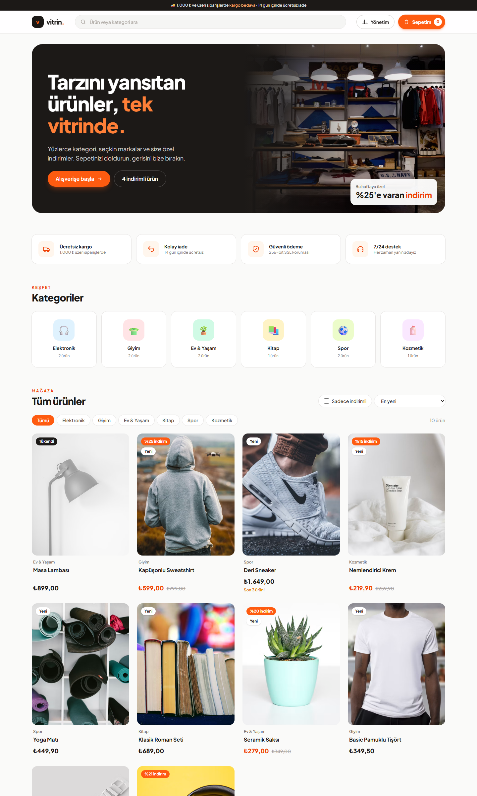
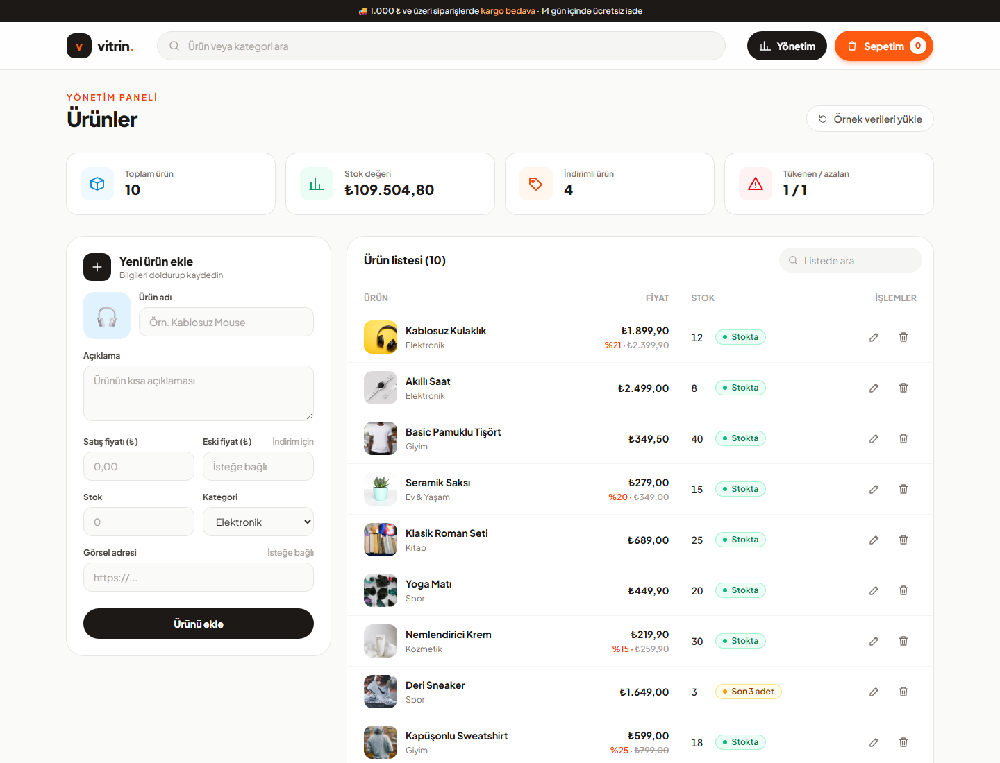
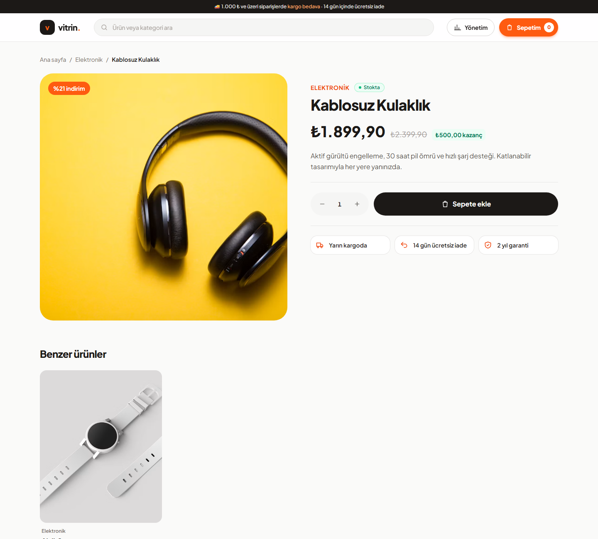

# vitrin. 🛍️

React, TypeScript ve Tailwind CSS ile geliştirilmiş modern bir e-ticaret uygulaması.
Web Geliştirme; JavaScript eğitimi proje ödevi kapsamında hazırlanmıştır.

**Canlı demo:** [vitrin-app.netlify.app](https://vitrin-app.netlify.app)



## Özellikler

### Ürün yönetimi (`/yonetim`): CRUD
| İşlem | Açıklama |
|---|---|
| **Ekle** | Form ile yeni ürün ekleme (ad, açıklama, fiyat, indirim için eski fiyat, stok, kategori, görsel). Alanlar doğrulanır. |
| **Listele** | Ürünler tabloda listelenir ve aranabilir. Mağazada arama, kategori filtresi, indirim filtresi ve sıralama bulunur. |
| **Güncelle** | Düzenle simgesiyle ürün bilgileri forma yüklenir ve kaydedilir. |
| **Sil** | Onay penceresinden sonra ürün silinir (sepetten de otomatik çıkarılır). |

Panelde ayrıca toplam ürün, stok değeri, indirimli ürün ve tükenen/azalan stok özet kartları yer alır.

### Mağaza ve sepet
- Karşılama alanı, avantajlar, kategori kartları ve ürün vitrini
- İndirim rozetleri, "Yeni" etiketi, tükenen ve az kalan stok uyarıları
- Ürün detay sayfası (`/urun/:id`) ve benzer ürünler
- Sepet (`/sepet`): adet artırma/azaltma, ürün çıkarma, ücretsiz kargo ilerleme çubuğu, indirim kazancı
- "Siparişi tamamla" ile stoklar düşer ve sepet boşalır
- Veriler **LocalStorage**'da saklanır; sayfa yenilense de kaybolmaz
- Bildirimler (toast) ve mobil uyumlu tasarım

## Kullanılan teknolojiler
- [React 19](https://react.dev) + [TypeScript](https://www.typescriptlang.org)
- [Vite](https://vite.dev)
- [Tailwind CSS 4](https://tailwindcss.com)
- [React Router](https://reactrouter.com)
- LocalStorage
- Ürün fotoğrafları: [Unsplash](https://unsplash.com)

## Klasör yapısı
```
src/
├── components/   # Tekrar kullanılabilir bileşenler (Navbar, Footer, ProductCard, ProductForm, Icons...)
├── pages/        # Sayfalar (HomePage, ProductDetailPage, CartPage, AdminPage)
├── interfaces/   # TypeScript tipleri (Product, CartItem)
├── context/      # Uygulama durumu (StoreContext: ürün + sepet işlemleri)
├── utils/        # LocalStorage ve biçimlendirme yardımcıları
└── data/         # Örnek ürün verileri
```

## Kurulum
```bash
npm install
npm run dev      # http://localhost:5173
npm run build    # dist/ klasörüne üretim çıktısı
```

## Ekran görüntüleri
| Yönetim paneli | Ürün detayı |
|---|---|
|  |  |
